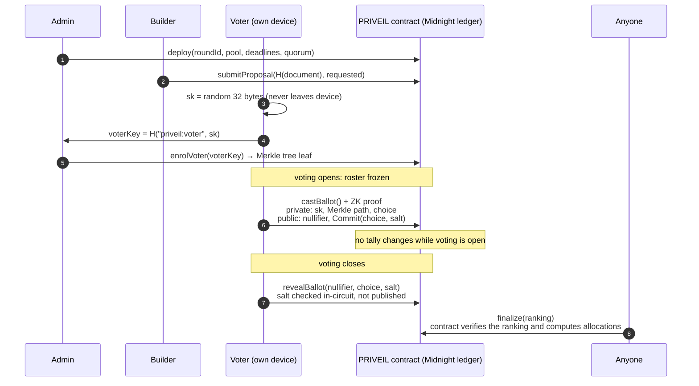
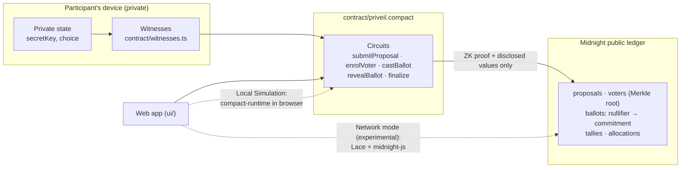

# PRIVEIL

**Fund builders. Protect voters.**

[](https://github.com/TeevincsCrypt/preveil/actions/workflows/ci.yml)   

PRIVEIL is a privacy-preserving grant allocation protocol built on [Midnight](https://midnight.network).
Communities, DAOs and ecosystem grant programs use it to allocate funding to builders **without
publicly exposing how each member voted**, while the final allocation stays **publicly verifiable**.

> Built for the Midnight Buildathon (AKINDO Wave Hacks, Wave 3). Apache-2.0.

| | |
|---|---|
| Smart contract | [`contract/priveil.compact`](contract/priveil.compact): Compact 0.28, compiles with `compactc` 0.36.1, including ZK proving keys for all 5 circuits |
| Contract spec | [`SPEC.md`](SPEC.md): public fields, private state, every assert, privacy invariants, accepted leaks |
| Tests | 44 tests that run the compiled contract (every guard, allocation vs. an independent model, privacy invariants), plus a Playwright end-to-end flow |
| App | React + Vite in [`ui/`](ui). Runs the compiled contract in the browser; Lace wallet connection |
| Pitch & demo | [`docs/PITCH_DECK.md`](docs/PITCH_DECK.md), [`docs/DEMO_SCRIPT.md`](docs/DEMO_SCRIPT.md) (2-minute video script), [`docs/SUBMISSION.md`](docs/SUBMISSION.md) |

---

## The problem

Grant voting today forces a bad trade-off:

- **Public votes invite pressure.** When every ballot is tied to a wallet, members vote for what is
  safe rather than what is best. They face social pressure, retaliation and whale influence.
- **Allocation is easy to game.** Duplicate wallets, leaked running tallies and bandwagon voting
  distort results.
- **Transparency costs privacy.** Programs must prove that funds were allocated by the rules. Today
  that means publishing every individual decision.

## The solution

PRIVEIL separates **private decisions** from **public outcomes**:

- Public grant rounds, public proposals, public rules, public results and allocations.
- Private voter identity, private ballot choice during voting, and private secrets.
- Duplicate-vote prevention with nullifiers. Eligibility is proven with a zero-knowledge Merkle
  membership proof.
- The contract itself verifies the final ranking and computes the allocation.

**A community can verify the outcome of a grant round without seeing how each member voted.**

## Why Midnight

Hiding a vote in a frontend protects nothing. PRIVEIL needs contracts that compute over private data
and prove they did it correctly:

- **Compact circuits with private witnesses.** The voter's secret, Merkle path and choice are
  private inputs. They are used inside the proof and never written to the ledger.
- **Explicit disclosure.** Every value that crosses into public state goes through `disclose()`,
  so the privacy boundary can be reviewed and tested.
- **Dual state.** The public ledger holds what must be verifiable (roots, nullifiers, commitments,
  tallies, allocations). Private state stays on each participant's device.
- **Standard-library primitives** (`MerkleTree`, `persistentHash`, `persistentCommit`, `blockTime*`)
  give us membership proofs, nullifiers, hiding commitments and deadlines without custom cryptography.

---

## How it works



### Architecture



### What is public and what is private

| Information | Where | Why |
|---|---|---|
| Round rules (pool, deadlines, quorum, admin key hash) | **Public**, sealed at deploy | nobody can change the rules mid-round |
| Proposals (document hash, requested amount, builder key) | **Public** | what is being funded; documents are verifiable against their hash |
| Eligibility tree of voter keys | **Public** | ballots prove membership against its root |
| Ballots: nullifier → commitment | **Public** | prevents double voting, hides the choice |
| Opened choices, tallies, allocations | **Public** after voting closes | the outcome |
| Each participant's secret key | **Private** | derives voter key, nullifier and salt |
| Which enrolled member cast which ballot | **Private** | the Merkle proof never names the leaf |
| The choice while voting is open | **Private** | only a salted commitment is stored |
| The ballot salt | **Private** | checked inside the circuit, never written |

### Cryptographic construction

```
voterKey   = persistentHash(["priveil:voter",     sk])                       → enrolled leaf
nullifier  = persistentHash(["priveil:nullifier", sk, roundId, contract])    → one per voter per round
salt       = persistentHash(["priveil:salt",      sk, roundId, contract])    → never published
commitment = persistentCommit(choice, salt)                                  → hides the choice
```

`castBallot` proves in zero knowledge that:

1. **Membership:** the caller knows `sk` such that `voterKey(sk)` is a leaf of the `voters` tree.
   Only the root is checked.
2. **Uniqueness:** `nullifier(sk)` is not yet in `ballots`.
3. **Validity:** the hidden `choice < proposalCount`. Only that boolean is disclosed.
4. **Binding:** the stored commitment is `Commit(choice, salt)` for that same secret.

### Allocation rule (verifiable)

`finalize(order)` is open to anyone. The contract checks that `order` lists every proposal exactly
once, sorted by votes with ties broken by earlier submission. Exactly one ordering passes. The
contract then walks the ranking: a proposal that reached the **quorum** and whose full request fits
in the **remaining pool** is funded in full. Otherwise it receives nothing and the walk continues.

### Privacy guarantees and limitations

**Guaranteed by the contract (and tested):**

- No secret key or salt is ever in public state.
- No ballot is linked to an enrolled voter key.
- Ballot choices are sealed while voting is open, so there is no running tally.
- One ballot per member per round; only enrolled members can vote; only real proposals can be chosen.
- The allocation follows the published rule, because the contract computes it.

**Known limitations (honest MVP scope):**

- After voting closes, each opened choice is public **under its anonymous nullifier**. Network
  metadata (fee payment, IP, timing) could link a transaction to a person.
- Ballots that are never revealed are not counted. Reveal can be delegated: anyone holding the
  opening can submit it.
- The admin is trusted to enrol the agreed roster (the roster is public).
- There is no coercion resistance: a voter can prove how they voted.
- Allocations are recorded on chain, not paid out.

See [`SPEC.md`](SPEC.md) for the full threat model.

---

## Repository layout

```
contract/
  priveil.compact          the Compact smart contract
  witnesses.ts             private-state witnesses (browser-safe)
  crypto.ts                key/nullifier/commitment helpers, which call the contract's pure circuits
  simulator.ts             runs the compiled contract on compact-runtime (tests and Local Simulation)
  privacy.ts               public-state privacy scanner (used by tests and the UI)
  managed/priveil/         compiler output (generated JS committed; proving keys are git-ignored)
src/test/
  priveil.test.ts          functional tests: every guard, results, allocation model
  privacy.test.ts          privacy invariants asserted over the decoded public ledger
  fixtures.ts
ui/
  src/engine/              demo store and deterministic seed (fictional demo data)
  src/pages/               landing, rounds, round (proposals/vote/results/ledger), create, submit, privacy, modes
  src/wallet/              Midnight DApp Connector (Lace) connection
  src/midnight/network.ts  experimental on-chain mode (midnight-js providers)
  e2e/demo-flow.cjs        Playwright end-to-end flow
SPEC.md                    contract specification
docs/                      pitch deck, demo script, submission text
```

---

## Getting started

### Prerequisites

- **Node.js 22** (`node -v`). npm comes with it.
- **Compact toolchain**, only needed to recompile the contract. The generated contract code is
  committed, so the app and tests run without it.

  ```bash
  curl --proto '=https' --tlsv1.2 -LsSf https://github.com/midnightntwrk/compact/releases/latest/download/compact-installer.sh | sh
  compact update 0.36.1
  compact compile --version     # → 0.36.1
  ```

### Install

```bash
git clone <this repo> priveil && cd priveil
npm install
```

### Run the app (Local Simulation)

```bash
npm run dev          # opens the app at http://localhost:5173
```

Or as a production build:

```bash
npm run build && npm run preview    # http://localhost:4173
```

### Compile the contract

```bash
npm run compile        # full compile, including ZK proving/verifier keys (~15 s, 80 MB of keys)
npm run compile:fast   # --skip-zk: generated JS only (enough for tests and the app)
```

Output goes to `contract/managed/priveil/` (`contract/` generated JS, `zkir/`, `keys/`, `compiler/`).

### Test

```bash
npm test               # 44 contract tests on the compiled contract
npm run typecheck
# End-to-end UI flow (needs a running preview on :4173 and Playwright with Chromium):
npm run build && npm run preview &
npm run e2e
```

The contract tests run the **compiler's own JavaScript output** on `@midnight-ntwrk/compact-runtime`
(the in-memory approach used by Midnight's official examples): the same asserts, witnesses and
ledger operations, with an explicit block time. Zero-knowledge proving is not part of these tests.

CI (`.github/workflows/ci.yml`) installs `compactc` 0.36.1, compiles with keys, checks that the
committed generated code matches a fresh compile, typechecks, runs the tests, builds the app and
runs the end-to-end flow.

---

## Demo guide

The app opens in **Local Simulation**, and a banner at the top says so on every page. The compiled
contract executes in the browser; proving and network submission are skipped. All rounds, sponsors
and projects are **fictional demo data**.

1. **Grant rounds** shows three rounds: one accepting proposals, one with voting open, one finalized.
2. Open **Privacy Builders Fund · Wave 3 → Vote**. You already hold a credential, generated on your
   device before voting opened.
3. Choose a proposal and **cast your private ballot**. Compare "Only on this device" with
   "On the public ledger", and check the live privacy scan.
4. Click **Vote again**. The contract rejects it with `Already voted in this round`. Try
   **an unenrolled credential**: rejected.
5. **Results** are sealed: the ledger has commitments and zero tallied votes.
6. In **Simulation controls**: let the remaining members vote, **Close voting**, reveal your ballot,
   let members open theirs, then **Finalize**.
7. **Results** shows the verified allocation, why each proposal was or wasn't funded, and five
   verification checks. **Public ledger** shows exactly what an indexer sees.
8. **Create round** deploys your own round instance. The constructor rejects invalid timelines.

### Wallet and network mode

**Modes & wallet** detects Midnight wallets injected into `window.midnight` (Lace) and connects
through the official DApp Connector API (`@midnight-ntwrk/dapp-connector-api` 4.0.1). It shows the
real network id and shielded address. The connection is real when a wallet is installed. Nothing is
shown as connected unless `connect()` succeeded.

Deploying a round to a network (`ui/src/midnight/network.ts`) uses the provider wiring from
Midnight's official UI template (midnight-js 5.0.1). It needs Lace on preprod or preview with tDUST,
plus the proving keys (`npm run compile`; they are copied to `ui/public/managed/priveil` by the dev
and build scripts). **This path type-checks but was not exercised against a live network from this
repository.** See Known limitations.

---

## Known limitations

- **No live-network deployment has been verified yet.** Development ran in a sandbox without a
  Docker daemon (so no local devnet or proof server) and without access to Midnight testnet
  endpoints. The contract compiles with ZK keys and is tested on compact-runtime; the network
  mode is wired but unverified.
- Local Simulation does not generate proofs. It enforces the contract's logic but not proof
  soundness.
- MVP limits: 8 proposals per round, 1024 voters per round, one vote per member (no weighting or
  quadratic voting).
- The privacy limitations listed above (opened choices are public under nullifiers, reveal
  liveness, trusted roster, no coercion resistance, metadata).

## Roadmap

1. **Threshold-encrypted ballots.** Ballots are sealed to a committee key, so there is no reveal
   step and no liveness gap.
2. **Anonymous eligibility credentials.** Issuer-signed attributes (e.g. "holds a contributor
   badge") verified in-circuit, so no admin-managed roster.
3. **Quadratic funding and voting** with private contribution amounts.
4. **On-chain payouts** in shielded tokens to the `builderPk` holder, with milestone-based release.
5. **Private grant applications.** Selective disclosure of applicant details to reviewers only.
6. **Multiple administrators** and committee governance; **reputation credentials**; Sybil-resistant
   participation.
7. **Public audit proofs** and integrations with ecosystem grant programs.

## License

Apache License 2.0. See [`LICENSE`](LICENSE) and [`NOTICE`](NOTICE). Test-harness and privacy-scan
patterns are adapted from [midnightntwrk/midnight-examples](https://github.com/midnightntwrk/midnight-examples)
(Apache-2.0).
